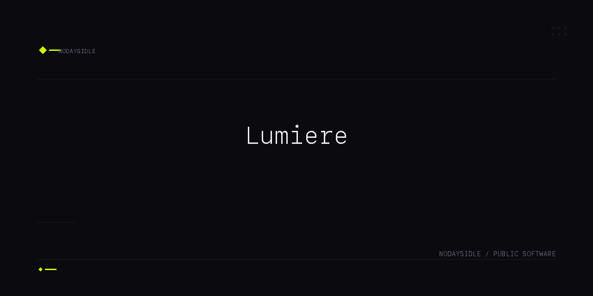
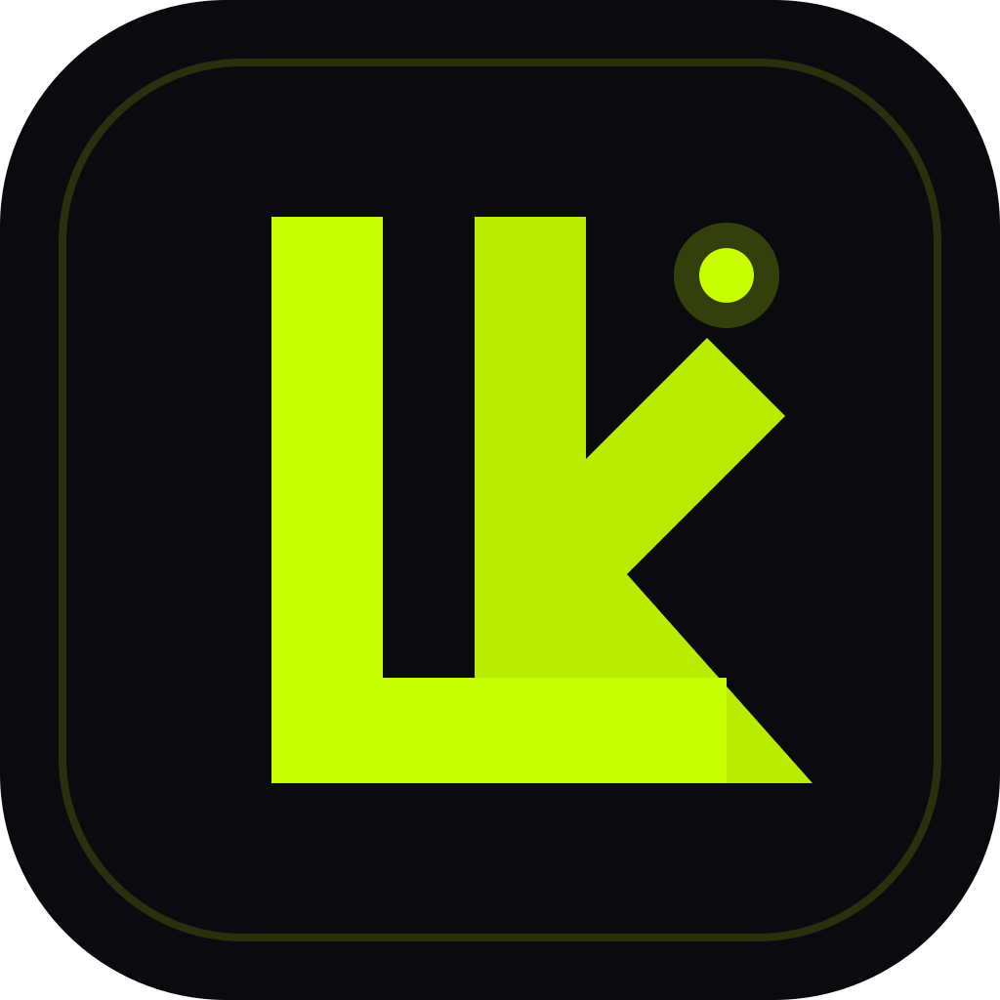

# Lumiere

> Native macOS screenshot polish and annotation — local-first, no network, no accounts.




## Overview

Lumiere is a native macOS app for turning clipboard screenshots into clean, annotated exports. It watches for copied images, applies local image cleanup, provides vector annotation tools, and exports PNG/JPEG/HEIC — all on-device with no network or backend dependencies.

## Features

- **Auto-capture** — clipboard monitoring detects screenshots and copied images automatically
- **Shadow styling** — apply directional shadow depth to screenshots
- **Perspective correction** — auto-detect document edges and correct perspective with Vision framework
- **Vector annotations** — arrow, rectangle, text, callout, and blur tools
- **Floating toolbar** — glass-panel NSPanel with cursor-proximity reveal and hide
- **Export** — PNG (lossless), JPEG, and HEIC output
- **Local-first** — no cloud, no telemetry, no accounts
- **Dark Volt UI** — NODAYSIDLE dark theme with `#C8FF00` accent

## Technology

| Area | Technology |
|------|------------|
| Language | Swift 6 |
| Interface | SwiftUI + AppKit (NSPanel, NSPasteboard, NSSavePanel) |
| Build | Xcode project (`xcodebuild`) |
| Image Processing | Core Image, Vision framework |
| Machine Learning | Core ML (heuristic fallback — no `.mlmodel` required) |
| Storage | SwiftData |
| Events | Combine |

## Requirements

- macOS 15.0 or later
- Xcode 16+ / Swift 6+
- Apple Silicon recommended

## Installation

The latest release ([v0.1.1](https://github.com/nodaysidle/nodaysidle-lumiere/releases/tag/v0.1.1)) has no downloadable assets. The newest pre-built app is [`Lumiere-v0.1.0-macos.dmg`](https://github.com/nodaysidle/nodaysidle-lumiere/releases/download/v0.1.0/Lumiere-v0.1.0-macos.dmg) on [v0.1.0](https://github.com/nodaysidle/nodaysidle-lumiere/releases/tag/v0.1.0) (no checksum file is attached).

1. Open the DMG and drag `Lumiere.app` to `/Applications`
2. **Right-click → Open** on first launch to bypass Gatekeeper

Or build from source (macOS 15+, Xcode):

```bash
Scripts/package-internal-dmg.sh
open build/Lumiere-Internal-AdHoc.dmg
```

The DMG is **not Developer ID signed or notarized**. For NDI/Kaly internal use and trusted installs only.

## Development

```bash
# Debug build
xcodebuild -project Lumiere.xcodeproj -scheme Lumiere -configuration Debug -derivedDataPath build/DebugDerivedData build

# Run tests (8 tests)
xcodebuild -project Lumiere.xcodeproj -scheme Lumiere -destination 'platform=macOS' -derivedDataPath build/TestDerivedData test

# Internal DMG
Scripts/package-internal-dmg.sh
```

## Project Structure

```text
Lumiere/
├── Core/                    Logging, services, theme
│   ├── Services/            ClipboardMonitor, ImageProcessing, CoreML, Annotations, Settings
│   └── Theme/               Color+Palette (Volt #C8FF00)
├── Features/
│   ├── UI/                  Views (ImageDisplay, GlassPanel, DrawingLayer, AnnotationInput), PanelManager
│   └── Settings/            SettingsView
├── Models/                  Annotation, ImageProcessing, CaptureEvent, Settings types
└── Resources/               AppIcon, LumiereLogo.svg
```

## Privacy

Lumiere is intentionally local-first:

- No network calls
- No cloud processing
- No telemetry
- No accounts
- All image processing happens on-device
- Clipboard access is read-only; no clipboard data is persisted beyond the current session

## License

MIT.

## Author

[NODAYSIDLE](https://github.com/nodaysidle)
